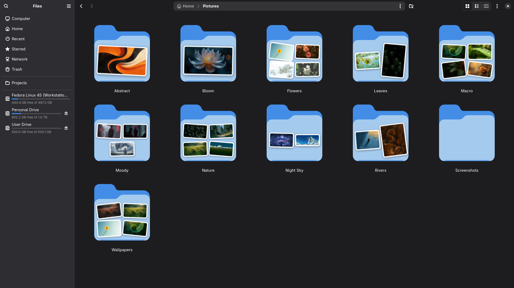
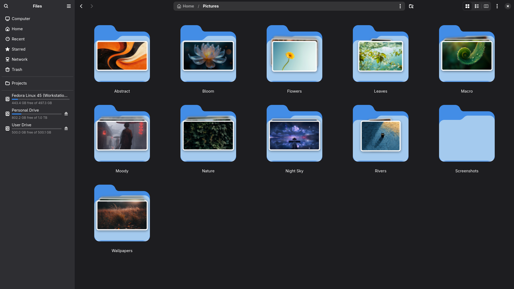
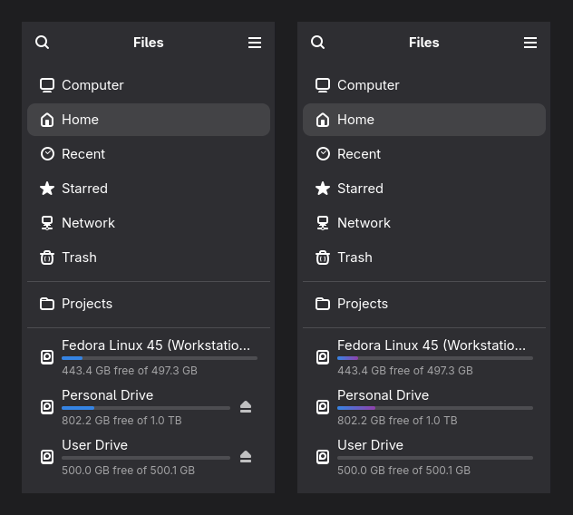
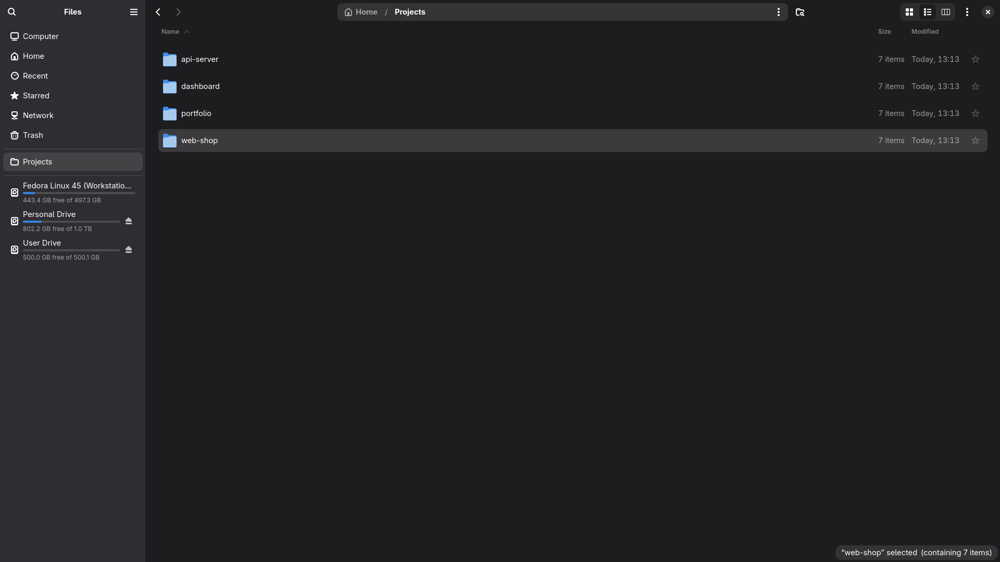
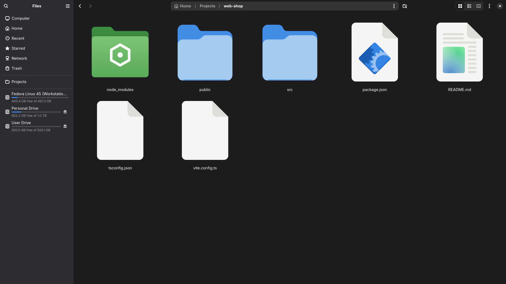
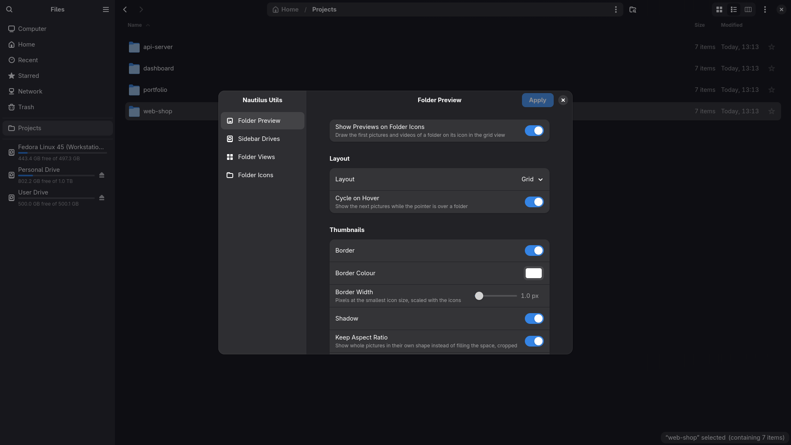
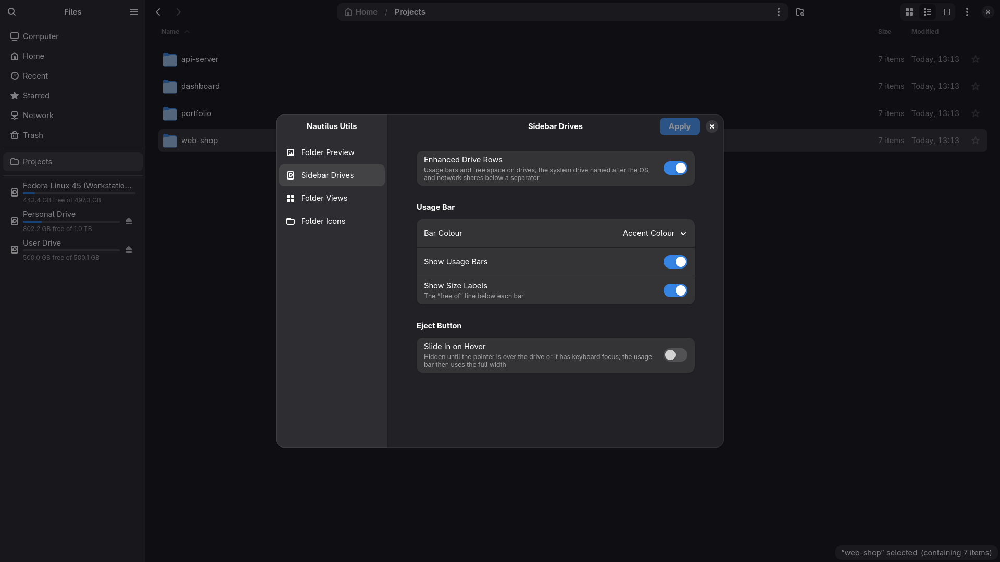
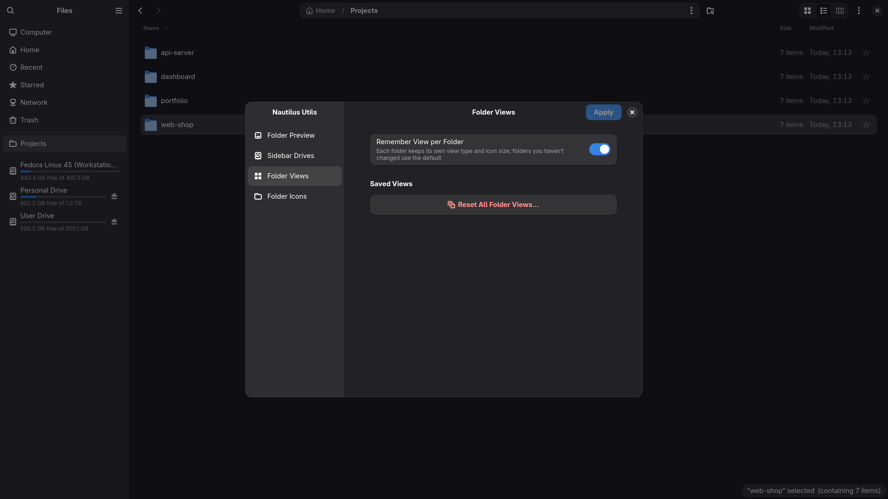
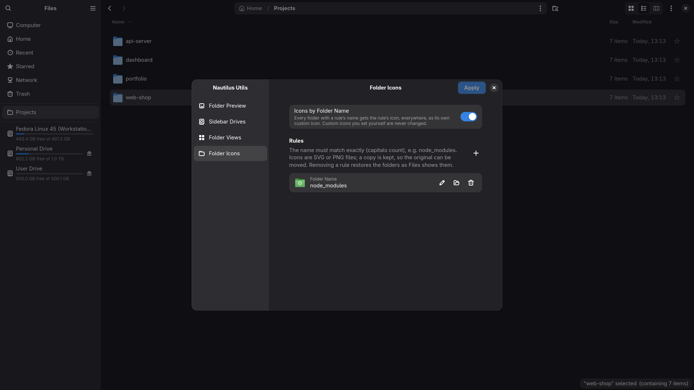

<div align="center">

# 🗂️ nautilus-utils

**Extra features for GNOME Files (Nautilus): folder previews, drive usage bars, per-folder views and folder icons by name.**

Shipped as one native C extension module (`libnautilus-utils.so`) with its own settings window.

[](LICENSE)




</div>

---

## 📑 Contents

- [✨ Features](#-features)
  - [🖼️ Folder previews](#️-folder-previews)
  - [💽 Sidebar drives](#-sidebar-drives)
  - [👁️ Folder views](#️-folder-views)
  - [🎨 Folder icons by name](#-folder-icons-by-name)
  - [⚙️ Settings](#️-settings)
- [📦 Installation](#-installation)
  - [✅ Requirements](#-requirements)
  - [🎩 Fedora](#-fedora)
  - [🍥 Ubuntu / Debian](#-ubuntu--debian)
  - [🏔️ Arch Linux / Manjaro](#️-arch-linux--manjaro)
  - [🐧 Any other distribution](#-any-other-distribution)
  - [🔍 Check that it works](#-check-that-it-works)
  - [🗑️ Uninstall](#️-uninstall)
- [🛠️ Development](#️-development)
- [📄 License](#-license)

---

## ✨ Features

| | Feature | What it does |
|---|---|---|
| 🖼️ | **Folder previews** | Folder icons in the grid view show the pictures, videos and album covers inside them, and cycle through them on hover. |
| 💽 | **Sidebar drives** | Drives in the sidebar get a usage bar and "X free of Y", plus a row for your OS drive and your mounted network shares. |
| 👁️ | **Folder views** | Every folder remembers its own view (grid or list) and icon size. |
| 🎨 | **Folder icons by name** | Give every folder with a certain name (e.g. `node_modules`) its own icon, everywhere. |
| ⚙️ | **Settings** | One settings window for all features, opened from Files' main menu. |

Every feature can be switched off on its own. Files keeps working normally if a Nautilus update changes
something a feature relies on: that feature switches itself off and logs one warning.

### 🖼️ Folder previews

Dolphin-style folder thumbnails: each folder icon in the grid view shows its first images, videos and
album covers, and cycles through the next ones while the pointer hovers over it. Two layouts:

| Grid | Stacked |
|---|---|
|  |  |
| Tilted photos on the folder's front: 1 → one large photo, 2 → side by side, 3 → two on top and one below, 4+ → quarters. | Up to three rounded cards stacked inside the folder, the first picture in front. Hovering brings the next picture (or the next three) to the front. |

- 🎴 **Stacked extras:** your own **folder icon** SVG and a **front overlay** SVG drawn over the cards, so
  the pictures look like they sit inside the folder. Both SVGs are drawn at the size of the icon: give them
  the same canvas and place the overlay where it belongs inside its SVG.
- 🌫️ **Depth effect** (Blur, Transparency or Darken) makes the cards further back look further away; the
  front card always stays upright.
- 📐 **Layout:** side padding (8 px by default at the 64 × 64 size, scaled with the zoom), position (Top,
  Centre, Bottom, plus a fine-tuning slider), a bottom fade, and rounded top/bottom corners that clip all
  pictures.
- 🖌️ **Both layouts:** border (on/off, colour and width), drop shadow (it follows the picture's shape, so
  transparent logos get a soft outline shadow instead of a box), keep aspect ratio (off = pictures fill
  their space, cropped), corner radius, random rotation and cycling on hover.
- 📁 Only folders with the theme's plain folder icon get previews. Special folders (Pictures, Downloads, …,
  `folder-*` icons) and folders with a custom icon keep their own icon.

<details>
<summary><b>⚠️ Known limitations</b></summary>

- **Nautilus updates may switch the previews off.** Nautilus has no API for custom icons or hover, so the
  feature uses Nautilus' private grid widgets (verified on Nautilus 51.1). If an update changes them, it
  logs one warning ("folder previews disabled: …") and Files keeps working with plain folder icons.
- **Grid view only.** List view shows plain icons.
- **Local folders only** (no network, MTP, etc.).
- A preview is keyed by the folder's modification time. Changes *inside* a folder you are looking at are
  picked up live; editing a file in place (which doesn't change the folder's time) shows up after the
  folder itself changes or the cache is cleared.
- Custom folder SVGs need GTK 4.22 or newer (GTK's own SVG renderer; animations and external files are
  ignored). An unreadable file counts as not set.
- Audio cover art needs `gst-thumbnailers`; audio without cover art is skipped.
- With **nautilus-python** extensions installed, Nautilus can stall for up to ~0.5 s while scrolling large
  folders whether or not this extension is installed (Python's global interpreter lock).

Clear the frame cache with `rm -rf ~/.cache/nautilus-utils/folder-preview` (rebuilt on demand). Thumbnails
themselves live in the shared `~/.cache/thumbnails`.

</details>

### 💽 Sidebar drives

Turns the drive rows of the sidebar into rows with a usage bar and free space, like the Computer view.
Left: the default accent-colour bars. Right: a gradient, with the eject buttons sliding in only on hover.

<p align="center">
  
</p>

- 🖥️ **OS drive:** a row named after the installed OS (`PRETTY_NAME` from os-release) directly above the
  other drives. Clicking it opens `/`; right-clicking it (or the Menu key) opens Files' own drive menu (Open,
  Open in New Tab, Open in New Window, Properties). Nautilus' own "Computer" row is left untouched.
- 💾 **Local drives:** Nautilus' drive rows get a bar and "X free of Y" under their name; eject, right-click
  menu and drag-and-drop work as before.
- 🌐 **Network shares** (mounted ones, e.g. SMB/SFTP, or NFS/CIFS mounted by the system) are listed below a
  separator under the local drives, with a bar when the server reports its size. Clicking opens the share,
  the eject button unmounts it.
- 🎨 **Colours:** bars use the accent colour by default, turning the warning colour from 90 % full and the
  error colour from 95 %. A custom colour or a two-colour gradient can be chosen instead (these replace the
  warning/error colours). Light, dark and high-contrast themes are followed.
- ⏏️ **Slide In on Hover:** the eject buttons stay hidden and the bars use the full row width; hovering a
  drive (or giving it keyboard focus) slides its eject button in, and the row's text and bar fade out
  underneath it.
- 🔄 Free space is refreshed when a window gets focus and every 60 s. A slow or unreachable server never
  blocks Files: its size query gives up after 3 s and keeps the last values.

<details>
<summary><b>⚠️ Known limitations</b></summary>

- **Nautilus updates may switch the feature off.** It relies on Nautilus' private sidebar widgets
  (verified on Nautilus 51.1). If they change, it logs one warning ("sidebar drives disabled: …") and the
  sidebar stays as stock Nautilus.
- Only mounted network shares are listed (mount them via *Network*). Their right-click menu and dropping
  files onto them are not available (Nautilus sorts shares above the local drives and its rows can't be
  re-sorted, so these are the extension's own rows).

</details>

### 👁️ Folder views

Every folder remembers its own **view type** (grid or list) and **icon size**, like Windows File Explorer.
Switch a folder to list view (or zoom it with <kbd>Ctrl</kbd> <kbd>+</kbd> / <kbd>Ctrl</kbd> <kbd>−</kbd> /
<kbd>Ctrl</kbd> + scroll) and only that folder changes; other folders, tabs and windows keep theirs.



- 📏 Each folder keeps one icon size per view type, so switching it back to the grid restores its grid size.
- 🏠 A folder you never changed uses the **default** view and icon size. The default is copied once from
  Files' own setting the first time the feature runs, and changing a folder never changes it.
- 💾 Views are saved in the folder's GIO metadata (where Files keeps each folder's sort order), so they
  survive restarts and follow folders you rename or move in Files. This works on local and NTFS drives,
  read-only folders, Trash and Recent.
- ⭐ **Starred**, **Other Locations** and Files' global search always use the default (they can't store a
  view). A search inside a folder keeps that folder's view. The Network view is left alone.
- ♻️ **Reset All Folder Views…** (in the settings) makes every folder use the default again. Switching the
  feature off puts Files' own default back, so Files behaves as before.

<details>
<summary><b>⚠️ Known limitations</b></summary>

- **Nautilus updates may switch the feature off.** It relies on Nautilus' private tab and view widgets
  (verified on Nautilus 51.1). If they change, it logs one warning ("folder views disabled: …") and Files
  keeps its normal global view.
- The saved views of a folder's subfolders, siblings and parent are read in the background after it loads,
  so the next folder's view is known when you click. When two folders in a row have different view types,
  the old folder stays on screen as a still picture while the new one loads, and appears at once when its
  files are in. The switch underneath is Files' own view rebuild (what <kbd>Ctrl</kbd> <kbd>1</kbd> /
  <kbd>Ctrl</kbd> <kbd>2</kbd> costs, 0.1–0.3 s), so such a folder appears about 0.1 s later than in stock
  Files; folders with the same view type open as fast as stock.
- Network shares (SMB, SFTP) haven't been tested yet; reading a saved view never blocks Files.

</details>

### 🎨 Folder icons by name

Give every folder with a certain name its own icon, everywhere: for example all your `node_modules`
folders. Add a rule (folder name + an SVG or PNG icon) under **Nautilus Utils Settings → Folder Icons**.



Each folder Files lists whose name matches exactly (capitals count) gets the icon as **Files' own custom
icon** (the same as *Properties → custom icon*), so it shows in the grid and list view, the path bar and
Properties.

- 🔒 Custom icons you set yourself are never changed: the extension only touches folders it marked.
- ⚡ Folders on screen update at once; others get the icon the first time Files lists them.
- ↩️ Removing a rule (or switching the feature off) restores the folders it changed as Files lists them
  again. A folder that is never opened again keeps the icon until then (finding every folder would mean
  scanning the whole disk).
- 📋 The chosen icon is copied to `~/.local/share/nautilus-utils/folder-icons/`, so the original can be
  moved or deleted.
- 🌐 Where a location can't store this kind of folder information (some network shares), folders keep their
  normal icon.
- 🧹 Like any custom icon, the icons stay if the extension is uninstalled: remove the rules first to restore
  the folders.

### ⚙️ Settings

Files' main menu (☰) gets a **Nautilus Utils Settings** entry above *Preferences*. The window lists the
features in a sidebar; every feature's page can switch it on or off. Changes only take effect when you
press **Apply**; closing the window without Apply discards them.



<details>
<summary><b>🖼️ More settings pages</b></summary>

| Sidebar Drives | Folder Views | Folder Icons |
|---|---|---|
|  |  |  |

</details>

| Page | Options |
|---|---|
| 🖼️ **Folder Preview** | On/off, layout (Grid or Stacked), cycle on hover, pictures per step and depth effect (Stacked), border, border colour, border width, shadow, keep aspect ratio, corner radius, random rotation. Stacked only: position, vertical offset, bottom fade, top/bottom corner radius, custom folder icon and front overlay (SVG files; the path is stored, so keep the files where they are). |
| 💽 **Sidebar Drives** | On/off, bar colour (accent colour, a custom colour, or a two-colour gradient), show/hide the usage bars and the size labels, slide the eject button in only on hover. |
| 👁️ **Folder Views** | Remember the view per folder (on/off) and **Reset All Folder Views…**, which asks for confirmation and acts right away (it isn't a setting waiting for Apply). |
| 🎨 **Folder Icons** | Icons by folder name (on/off) and the rules: folder name, icon (Choose Icon…), remove; add a rule with **+**. Invalid or duplicate names are marked red. |

The settings are stored with GSettings (schema `io.github.zyrotec.NautilusUtils`; inspect them with
`gsettings list-recursively io.github.zyrotec.NautilusUtils`). If the schema isn't installed, the features
run with their defaults, the window says so, and Files logs one warning.

---

## 📦 Installation

### ✅ Requirements

| Component | Version | Why |
|---|---|---|
| 🗂️ Nautilus (GNOME Files) | **51** or newer | The features hook into Nautilus 51's widgets; on older versions they switch themselves off. |
| 🧱 GTK | 4.22 or newer | Custom folder SVGs use GTK's own SVG renderer (the build itself needs 4.12). |
| 🎛️ libadwaita | 1.9 or newer | The settings window's sidebar. |
| 🧰 GLib | 2.80 or newer | |
| 🔨 meson + ninja, a C11 compiler | meson 1.0 or newer | Building. |
| 🎵 gst-thumbnailers | optional | Album covers in folder previews. |

In practice this means a distribution with **GNOME 51**:

| Distribution | Works? | Nautilus |
|---|---|---|
| Fedora 45 | ✅ (tested) | 51 |
| Arch Linux | ✅ | 51 |
| Manjaro | ✅ once its *stable* branch has Nautilus 51 (check with `pacman -Q nautilus`) | |
| Debian testing / unstable | ✅ | 51 |
| Ubuntu 26.10 | ✅ | 51 |
| Ubuntu 26.04 LTS | ❌ too old: builds, but the features switch themselves off | 50 |
| Debian 13 (trixie) | ❌ too old: libadwaita 1.7 can't build the settings window | 48 |

Check your version with `nautilus --version`.

All the guides below install the extension system-wide: Nautilus only loads extensions from its system
extension folder, so there is no per-user install. Installing also installs and compiles the settings
schema, so no extra step is needed for it.

### 🎩 Fedora

```bash
# 1. Build tools and libraries
sudo dnf install git meson ninja-build gcc nautilus-devel glib2-devel gtk4-devel libadwaita-devel \
                 gnome-desktop4-devel gdk-pixbuf2-devel cairo-devel gst-thumbnailers

# 2. Get the source and build it
git clone https://github.com/zyrotec/nautilus-utils.git
cd nautilus-utils
meson setup build --prefix=/usr --buildtype=release -Dwerror=false
ninja -C build

# 3. Install and restart Files
sudo meson install -C build
nautilus -q
```

Or build an RPM (installs and uninstalls cleanly with `dnf`):

```bash
sudo dnf install rpm-build glibc-langpack-en shared-mime-info
tools/make-tarball.sh                                  # → ~/rpmbuild/SOURCES/nautilus-utils-<version>.tar.xz
rpmbuild -ba packaging/nautilus-utils.spec
sudo dnf install ~/rpmbuild/RPMS/x86_64/nautilus-utils-*.rpm
nautilus -q
```

### 🍥 Ubuntu / Debian

Needs **Ubuntu 26.10** or **Debian testing / unstable** (see [Requirements](#-requirements)).

```bash
# 1. Build tools and libraries
sudo apt update
sudo apt install git meson ninja-build gcc pkg-config \
                 libnautilus-extension-dev libglib2.0-dev libgtk-4-dev libadwaita-1-dev \
                 libgnome-desktop-4-dev libgdk-pixbuf-2.0-dev libcairo2-dev shared-mime-info
sudo apt install gst-thumbnailers    # optional: album covers (skip if your release doesn't have it)

# 2. Get the source and build it
git clone https://github.com/zyrotec/nautilus-utils.git
cd nautilus-utils
meson setup build --prefix=/usr --buildtype=release -Dwerror=false
ninja -C build

# 3. Install and restart Files
sudo meson install -C build
nautilus -q
```

> [!NOTE]
> Debian and Ubuntu keep Nautilus extensions in `/usr/lib/x86_64-linux-gnu/nautilus/extensions-4`
> (or the folder for your architecture) rather than Fedora's `/usr/lib64/...`. The build asks
> `pkg-config` for the right folder, so nothing needs changing.

### 🏔️ Arch Linux / Manjaro

On Manjaro, first check that `pacman -Q nautilus` shows 51 or newer.

```bash
# 1. Build tools and libraries (libnautilus-extension holds the extension headers on Arch)
sudo pacman -Syu --needed base-devel git meson ninja \
                 nautilus libnautilus-extension glib2 gtk4 libadwaita gnome-desktop-4 \
                 gdk-pixbuf2 cairo gst-thumbnailers

# 2. Get the source and build it
git clone https://github.com/zyrotec/nautilus-utils.git
cd nautilus-utils
meson setup build --prefix=/usr --buildtype=release -Dwerror=false
ninja -C build

# 3. Install and restart Files
sudo meson install -C build
nautilus -q
```

> [!TIP]
> Arch updates GNOME quickly. If a Nautilus update ever breaks one of the features, Files logs a warning
> and keeps working; rebuild from the latest source (`git pull && ninja -C build && sudo meson install -C build`).

### 🐧 Any other distribution

The extension needs these `pkg-config` modules (install your distribution's *-devel* / *-dev* packages that
provide them):

| pkg-config module | Version | Usual package name |
|---|---|---|
| `libnautilus-extension-4` | ≥ 43 (Nautilus 51 at runtime) | `nautilus-devel`, `libnautilus-extension-dev`, `libnautilus-extension` |
| `glib-2.0`, `gio-2.0`, `gobject-2.0`, `gmodule-2.0` | ≥ 2.80 | `glib2-devel`, `libglib2.0-dev` |
| `gtk4` | ≥ 4.12 (4.22 for custom SVGs) | `gtk4-devel`, `libgtk-4-dev` |
| `libadwaita-1` | ≥ 1.9 | `libadwaita-devel`, `libadwaita-1-dev` |
| `gnome-desktop-4` | ≥ 43 | `gnome-desktop4-devel`, `libgnome-desktop-4-dev` |
| `gdk-pixbuf-2.0` | any | `gdk-pixbuf2-devel`, `libgdk-pixbuf-2.0-dev` |
| `cairo` | ≥ 1.14 | `cairo-devel`, `libcairo2-dev` |

Plus `meson` (≥ 1.0), `ninja`, a C11 compiler (`gcc` or `clang`) and `pkg-config`. Then:

```bash
git clone https://github.com/zyrotec/nautilus-utils.git
cd nautilus-utils
meson setup build --prefix=/usr --buildtype=release -Dwerror=false
ninja -C build
sudo meson install -C build
nautilus -q
```

- 📂 The module is installed into the folder Nautilus reports
  (`pkg-config --variable=extensiondir libnautilus-extension-4`). To use another folder, pass
  `-Dextensiondir=/path/to/extensions-4` to `meson setup`.
- 🧩 `--prefix=/usr` puts the settings schema in `/usr/share/glib-2.0/schemas`, where every distribution
  looks. With another prefix, make sure `<prefix>/share` is in `XDG_DATA_DIRS`.

### 🔍 Check that it works

1. Open **Files**. If it was already running, quit it first with `nautilus -q`.
2. Open the main menu (☰): **Nautilus Utils Settings** should be there, above *Preferences*.
3. The drives in the sidebar should show usage bars, and folders with pictures should show previews in the
   grid view.

Nothing changed? Start Files from a terminal with log messages:

```bash
nautilus -q
G_MESSAGES_DEBUG="nautilus-utils folder-preview sidebar-drives settings folder-views folder-icons" nautilus
```

You should see lines such as `settings loaded (schema found)` and `folder-preview loaded`; a feature that
switched itself off logs a warning such as "folder previews disabled: …". Check that the module is
in Nautilus' extension folder:

```bash
ls "$(pkg-config --variable=extensiondir libnautilus-extension-4)"
```

### 🗑️ Uninstall

> [!IMPORTANT]
> Folder icons set by **Folder icons by name** are Files' own custom icons and stay after uninstalling.
> Remove your rules in the settings (and open the folders once) before uninstalling if you want them gone.

From the source folder you installed from:

```bash
sudo ninja -C build uninstall
sudo glib-compile-schemas /usr/share/glib-2.0/schemas
nautilus -q
```

RPM install: `sudo dnf remove nautilus-utils`, then `nautilus -q`.

To also remove your settings and caches:

```bash
gsettings reset-recursively io.github.zyrotec.NautilusUtils   # before uninstalling
rm -rf ~/.cache/nautilus-utils ~/.local/share/nautilus-utils
```

---

## 🛠️ Development

### 🔨 Build and test

```bash
meson setup build
ninja -C build
meson test -C build
```

> [!NOTE]
> One test sorts names with `LC_ALL=en_US.utf8` and needs that locale (Fedora: `glibc-langpack-en`;
> Debian/Ubuntu: enable `en_US.UTF-8` with `sudo dpkg-reconfigure locales`; Arch: uncomment it in
> `/etc/locale.gen` and run `sudo locale-gen`). Type detection by name needs `shared-mime-info`.

### 🔗 Install for development

Nautilus only loads extensions from its system folder. Link the build output there **once**; after that
every rebuild is picked up without `sudo`:

```bash
sudo ln -sf "$PWD/build/libnautilus-utils.so" \
            "$(pkg-config --variable=extensiondir libnautilus-extension-4)/libnautilus-utils.so"
```

Install the settings schema into your home folder (repeat when `data/*.gschema.xml` changes):

```bash
mkdir -p ~/.local/share/glib-2.0/schemas
cp data/io.github.zyrotec.NautilusUtils.gschema.xml ~/.local/share/glib-2.0/schemas/
glib-compile-schemas ~/.local/share/glib-2.0/schemas
```

Nautilus keeps running in the background, so a rebuild only takes effect after it quits:

```bash
nautilus -q
G_MESSAGES_DEBUG="nautilus-utils folder-preview sidebar-drives settings folder-views folder-icons" nautilus    # with log messages
```

Remove the dev link before a system-wide install
(`sudo rm "$(pkg-config --variable=extensiondir libnautilus-extension-4)/libnautilus-utils.so"`).

### 🛡️ Safety checks

```bash
# Extra tools — Fedora: sudo dnf install valgrind clang-analyzer libasan libubsan
#               Debian/Ubuntu: sudo apt install valgrind clang-tools
#               Arch: sudo pacman -S valgrind clang
tools/check-safety.sh                    # strict build, gcc -fanalyzer, scan-build, ASan+UBSan tests,
                                         # valgrind tests, coverage report. Non-zero exit = a finding.
tools/check-safety.sh asan               # run only some steps
tools/smoke-nautilus.sh DIR              # isolated real Nautilus with an ASan build
tools/smoke-nautilus.sh --auto 120 DIR   # unattended: scripted scroll/zoom/hover + sidebar steps + self-checks
SMOKE_FAKE_NETWORK="User Drive" tools/smoke-nautilus.sh --auto 120 DIR   # also exercise the network list
SMOKE_TOGGLES=5 tools/smoke-nautilus.sh --auto 60 DIR   # fewer settings on/off rounds (default 25)
```

Logs land in `safety-logs/`. The smoke test drives the settings (colours, show/hide, sliding eject,
feature on/off) through an in-memory settings store, and runs in its own D-Bus session, runtime folder and
data folder, so it never changes your own settings, folder views or icons.

### ⏱️ Benchmarks (folder previews)

```bash
tests/folder-preview/make-bench.sh         # 500 folders, ~517 000 files (hard links) in ~/.cache/folder-preview-bench
tools/bench-nautilus.sh                    # cold / warm / browse in an isolated Nautilus
BENCH_BASELINE=1 tools/bench-nautilus.sh   # the same browse with the feature's hook disabled
build/tests/folder-preview/bench-core DIR  # per-stage timings of the pipeline outside Nautilus
```

### 🗺️ Project layout

<details>
<summary><b>Show the source files</b></summary>

| Path | What |
|---|---|
| `src/extension.c` | Module entry points Nautilus calls; fans out to every feature |
| `src/<feature>/` | One directory per feature, with its own `meson.build` |
| `src/folder-preview/folder_preview.c` | Feature set-up / tear-down |
| `src/folder-preview/info_provider.c` | Supported Nautilus hook (`NautilusInfoProvider`) |
| `src/folder-preview/workers.c` | Shared prioritised worker pool (max 2 threads) for all blocking work |
| `src/folder-preview/scanner.c` | Finds the first eligible images/videos/audio in a folder |
| `src/folder-preview/thumbs.c` | Finds or generates their thumbnails in the shared cache |
| `src/folder-preview/composite.c` | Builds the frames (grid or stacked cards, style options) |
| `src/folder-preview/cache.c` | Memory + disk cache of frames; the request pipeline |
| `src/folder-preview/folder_paintable.c` | Draws the folder icon (or custom SVG), the frame and the overlay |
| `src/folder-preview/icon_art.c` | Custom folder SVGs → textures at exact sizes; the folder's opaque body |
| `src/folder-preview/view_hook.c` | **Unsupported**: hooks into Nautilus' private grid widgets |
| `src/folder-preview/config.h` | Tunable constants |
| `src/sidebar-drives/sidebar_drives.c` | Feature set-up / tear-down |
| `src/sidebar-drives/drive_info.c` | OS name, local/network classification, async size queries with timeout, usage text |
| `src/sidebar-drives/sidebar_hook.c` | **Unsupported**: hooks into Nautilus' private sidebar widgets (drive rows, OS row, network list) |
| `src/sidebar-drives/bar_style.c` | Bar colours from the settings, as CSS |
| `src/sidebar-drives/fade_bin.c` | Container that fades its content out under the sliding eject button |
| `src/sidebar-drives/config.h` | Tunable constants |
| `src/folder-icons/folder_icons.c` | Folder icons by name: set-up, settings, re-check of listed folders |
| `src/folder-icons/fi_rules.c` | Rules, markers and the decide-what-to-do table |
| `src/folder-icons/fi_apply.c` | Applies the decisions through Files' custom-icon metadata (worker threads, bounded) |
| `src/folder-icons/fi_provider.c` | Supported Nautilus hook (`NautilusInfoProvider`) |
| `src/common/nu_icon_store.c` | Copies chosen icons into the data dir |
| `src/folder-views/folder_views.c` | Feature set-up / tear-down, follows the settings |
| `src/folder-views/fv_state.c` | Saved-value format, location kinds, zoom levels, in-memory cache |
| `src/folder-views/view_mode_hook.c` | **Unsupported**: hooks into Nautilus' private tabs and views (switch view, zoom, detect the user's changes) |
| `src/folder-views/config.h` | Tunable constants |
| `src/common/nu_settings.c` | Shared settings service (GSettings snapshot + change notifications) |
| `src/settings/settings_dialog.c` | The "Nautilus Utils Settings" window |
| `src/settings/folder_icons_page.c` | Its "Folder Icons" page |
| `src/settings/menu_hook.c` | **Unsupported**: adds the entry to Nautilus' private main menu |
| `data/*.gschema.xml` | GSettings schema |
| `tests/<feature>/` | GLib unit tests (`meson test`) |
| `tools/` | Safety, smoke-test, benchmark and packaging scripts |
| `packaging/` | Fedora RPM spec |
| `docs/screenshots/` | README screenshots |
| `PLAN.md` | Design, rules, decisions and measured results for every feature |

</details>

### ➕ Adding a feature

1. Plan it in `PLAN.md` (§6 is the template), then create `src/<feature>/` with a `meson.build` that
   appends its static libraries to `feature_libs` and its dependencies to `feature_deps`, and sets its own
   `G_LOG_DOMAIN`.
2. Expose `initialize (GTypeModule *)`, `shutdown (void)` and `list_types (int *)` and add them to the
   `features[]` table in `src/extension.c`.
3. Add `subdir()` calls in the top-level `meson.build` for the sources and the tests.

---

## 📄 License

[MIT](LICENSE) © 2026 zyrotec
